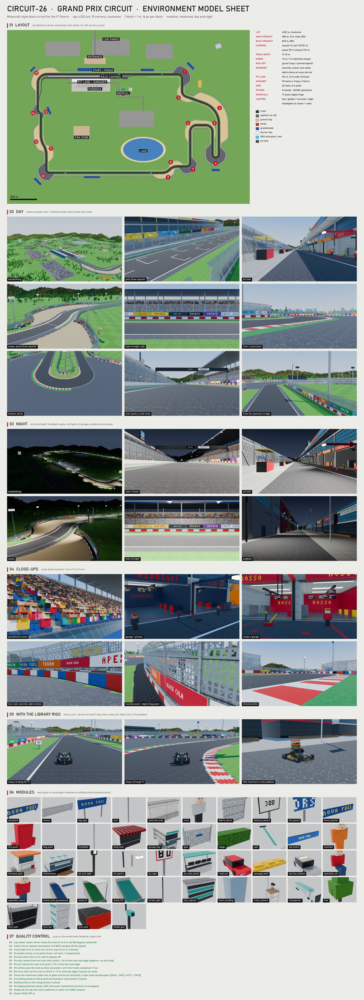

# Grand Prix circuit (voxel, Minecraft style)

One circuit, every video. Built the same way as the cars, kart and character: data first (`layout.py`, `plan.py`),
then the Blender build. Don't model a track inside a video folder; load this one, and change the layout or plan
here and rebuild.



- **Lap:** 4.32 km, 15 corners, clockwise. Main straight 980 m (15 m wide), back straight 839 m, both with DRS.
  Hairpin T4; fast sweepers T3 and T10; esses T8–9; fast S T11–12; chicane T13–14 with sausage kerbs; last corner T15.
- **Scale:** 1 block = 1 m with 16 px per block, so a texel is 6.25 cm, close to the character's 4.5 cm skin pixel.
  The block character is 1.44 m tall and the F1 car 5.6 m long. Kerbs and paint are 0.25 m sub-blocks.
- **Axes:** these match the car and character libraries: +X east, +Y north, +Z up, ground at z = 0. The main straight
  runs east along y = 0, with the start line at x = 0.

## Use it in a shot

```python
import sys; sys.path.insert(0, r"<Claude-Video-Editor>/library/environments/f1_circuit")
import circuit_blender as cb, cameras
cb.load_circuit(time_of_day="day")          # day | golden | overcast | night  (append blend/circuit.blend)
cameras.use("cam_grid_three_quarter")       # 20 presets, see below; or cameras.aim(name, loc, target, lens)

x, y, h = cb.lap_frame(s=350.0, offset=-2.0)        # any point on the lap: s metres from the start of the main
car.location = (x, y, 0); car.rotation_euler.z = cb.car_yaw(h)   # straight, offset + = left of the centre line
x, y, yaw = cb.grid_slot(1)                          # grid positions 1-20 (pole on the right, the inside of T1)
x, y, yaw = cb.pit_box("rosso")                      # a team's pit box, car nose-out
cb.set_flag(5, "yellow")                             # marshal post 5's digital flag panel (keyframe ["flag_on"])
cb.garage_door(team=1, bay=0, open_=0.0)             # roller doors (0 closed, 1 open); open by default
cb.set_time("night")                                 # floodlights, lit stands, garages and windows
```

Cars, drivers and karts come from their own libraries and work unchanged on the track: `car_blender.load_car`,
`seat_in_car`, `bake_roll` and the `steer` property. `test_animation.py` drives two cars through T1 and parks the
fifth-hand kart in the paddock.

## What's in it

All of it sits under the collection `circuit`, in sub-collections a shot can hide:

| collection | contents |
|---|---|
| `circuit_track` | one object per straight or corner (`track_main_straight`, `track_T1`, ...): asphalt, white lines, start/finish chequer, grid boxes, DRS lines, green run-off strips |
| `circuit_kerbs` | red/white kerbs per corner (`kerbs_T4`, ...) |
| `circuit_ground` | grass with mown stripes, gravel traps (sunk 8 cm), painted asphalt run-off, service roads, car parks, plazas, the lake, hills in 1 m terraces |
| `circuit_barriers` | concrete walls (white, or red/white near stands), armco, tyre walls (red/white/blue belts), debris fence on every barrier, service gates |
| `circuit_trackside` | 300/200/100 braking boards, DRS boards, sausage kerbs, 17 marshal posts with digital flag panels, fire points, TV camera towers, billboards, start gantry, sponsor banners and LED boards |
| `circuit_pit` | pit lane with team boxes, pit wall with team stands, building of 20 garage bays (2 per team, interiors, 3 floors, Paddock Club balcony), roller doors, gantries, tyre sets, jacks, wheel guns, signs, pit exit light |
| `circuit_stands` | 8 grandstands (main grandstand with a cantilever roof, corner stands, back-straight stand), flags |
| `circuit_crowd` | about 20,000 seated fans, standing fans on the general-admission banks, viewing platforms and in the fan zone, marshals, team crew |
| `circuit_operations` | race control tower, media centre, medical centre, helipad, fire station, CCTV, safety car + medical car bay, ambulance, fire truck, recovery trucks and cranes at the access gates |
| `circuit_paddock` | team motorhomes, transporters, paddock street lights |
| `circuit_venue` | entrance arch with turnstiles and ticket booths, spectator bridges, giant screens, viewing platforms, VIP terrace, hotel, fan zone (stage, marquees, food stalls), town |
| `circuit_vegetation` | about 20,000 blocky trees (broadleaf, pine, birch, poplar, bushes) |
| `circuit_vehicles` | parked cars in the car parks |
| `circuit_lighting` | sun, floodlight masts and their spot lights, roof floodlights, street lights |
| `circuit_cameras` | camera presets (below) |

**Modular:** every repeated piece is a prototype (`circuit_protos`, 57 groups) placed by one Geometry Nodes instancer
object per group. Its points carry `rot`, `scl` and `var` (variant) attributes. To adjust one piece, move that point
in Edit Mode; to swap a sponsor or colour, change `var`. Big one-off structures are their own objects. Nothing is
merged into one giant mesh.

**Camera presets** (plain cameras, none locked): `cam_establishing`, `cam_aerial_top` (orthographic),
`cam_grid_track_level`, `cam_grid_three_quarter`, `cam_pit_lane`, `cam_garage`, `cam_pit_box`, `cam_pit_wall`,
`cam_T1_track_level`, `cam_hairpin_aerial`, `cam_chicane_kerbs`, `cam_esses_three_quarter`, `cam_back_straight_side`,
`cam_bridge_view`, `cam_last_corner`, `cam_grandstand_pov`, `cam_crowd_close`, `cam_paddock`, `cam_marshal_post`,
`cam_tyre_wall`.

## Change it

- **Layout:** edit `layout.TRACK` (straights and arcs; two straights are solved so the lap always closes),
  `CORNERS` (run-off kind and width, braking boards), widths, the pit lane and the grid. Everything else follows from
  lap distance: kerbs, run-off, barrier lines (clamped so they never cross into another part of the track or the pit
  lane), boards and marshal posts.
- **Venue:** `plan.py` has the teams, invented sponsors, stands, buildings, car parks, lake, bridges and town.
- Then rebuild and run QC (commands below).

## Commands (one per step)

```
B="C:/Program Files/Blender Foundation/Blender 5.2/blender.exe"; C=library/environments/f1_circuit
"$B" -b --factory-startup --python $C/build_circuit.py -- [--time day]       # build + save blend/circuit.blend (~2 min)
"$B" -b $C/blend/circuit.blend --python $C/qc.py [-- --renders]              # QC -> sheet/qc_report.md
"$B" -b $C/blend/circuit.blend --python $C/render_views.py -- --time night [--cams a,b] [--scale 0.6]
"$B" -b $C/blend/circuit.blend --python $C/render_catalogue.py               # module thumbnails
"$B" -b $C/blend/circuit.blend --python $C/test_animation.py -- [--video]    # library rigs on the track
.venv-tools/Scripts/python $C/compose_sheet.py                               # sheet/model-sheet.png
"$B" -b $C/blend/circuit.blend --python $C/export_gltf.py -- [--parts track,kerbs,barriers,pit] [--name core]
```

## Quality control (`qc.py`, last run: PASS)

QC checks:
- **Track continuity:** the lap closes, the centre line is on asphalt everywhere, the track is never under 12 m
  wide, and the track and pit lane form one connected surface.
- **Pit lane:** the entry and exit join the track.
- **Barriers:** never on the track or kerbs, and the fence line is continuous except at the gates and the pit
  entry and exit.
- **Grounding:** every piece stands on the ground under it, and nothing solid is on the racing surface.
- **Clipping:** every pair of nearby pieces is tested box by box; the last run found 0 overlaps.
- **People:** 4,000 sampled spectators, marshals and crew don't clip into seats, platforms or posts.
- **Proportions:** a table of the main sizes.

Every builder records its boxes, so the clipping test uses real geometry.

## Performance

- **Saved blend:** about 45 MB, 800 objects.
- **Render load:** 55,000 instances, 7.4 M triangles drawn, but only 2.5 M unique.
- **EEVEE at 1080p and 48 samples:** about 7 s for the establishing shot and 4 s at track level (RTX 3050).
- **Floodlight spots:** 147, active only at night.

## Three.js

`export_gltf.py` writes glTF binary. Repeated pieces become EXT_mesh_gpu_instancing, which `GLTFLoader` turns into
`InstancedMesh`, and textures use nearest filtering.

| export | size | loaded in Three.js r186 (the repo's copy) |
|---|---|---|
| `--name core` (track, kerbs, barriers, pit, trackside) | 5.4 MB | 385 instanced meshes |
| full venue | 180 MB | 7.4 M triangles, 196k instances, ~30 fps in the app's browser |

`web/viewer.html` loads either one. Run it from the repo root with
`python -m http.server 8765`, then open `/library/environments/f1_circuit/web/viewer.html?file=circuit_core.glb`.
For a web scene, export only the collections the shot needs.

## Files

| file | what it does |
|---|---|
| `layout.py` | The lap as straights and arcs, plus corners, run-off, kerbs, DRS, braking boards, grid, pit lane, `frame(s, offset)` and `nearest()`. Pure numpy. |
| `plan.py` | Teams, sponsors, stands, buildings, car parks, lake, bridges, town, marshal posts. Pure python. |
| `ground.py` | The world as 1 m blocks (0.25 m along the track) and the barrier lines. Pure numpy. |
| `blocks.py` | Pixel materials, box mesh builder, `scatter()` instancing. |
| `terrain.py` | Merged block tops and side faces, split into track sections, kerbs, pit lane and ground tiles. |
| `props.py` / `buildings.py` | Every prototype and structure. |
| `circuit_blender.py` | Build, `load_circuit`, and the helpers above. |
| `lighting.py` / `cameras.py` | Day/golden/overcast/night lighting, and the camera presets. |
| `qc.py`, `test_animation.py`, `render_views.py`, `render_catalogue.py`, `compose_sheet.py`, `export_gltf.py` | QC, checks, renders and export. |

## Limits

- The site is flat: no elevation changes on the track.
- Kerbs are flush so wheels never clip; only the chicane's sausage kerbs are raised.
- The crowd is static: no bobbing yet.
- The full-venue glTF is heavy; export parts for the web.
